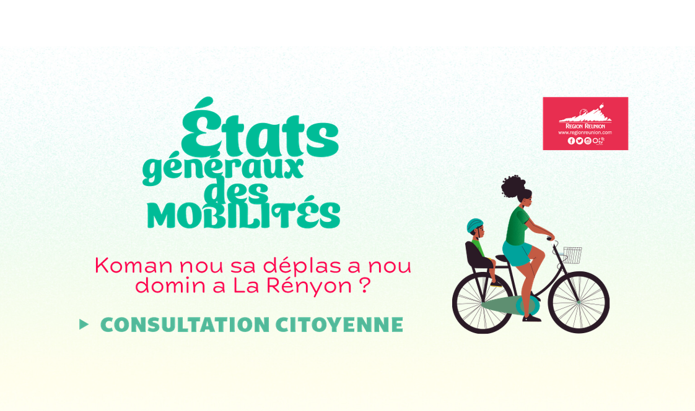
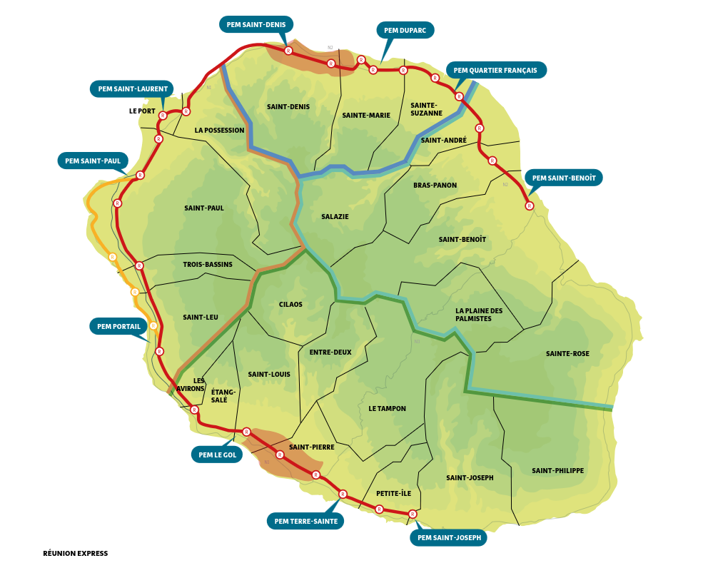
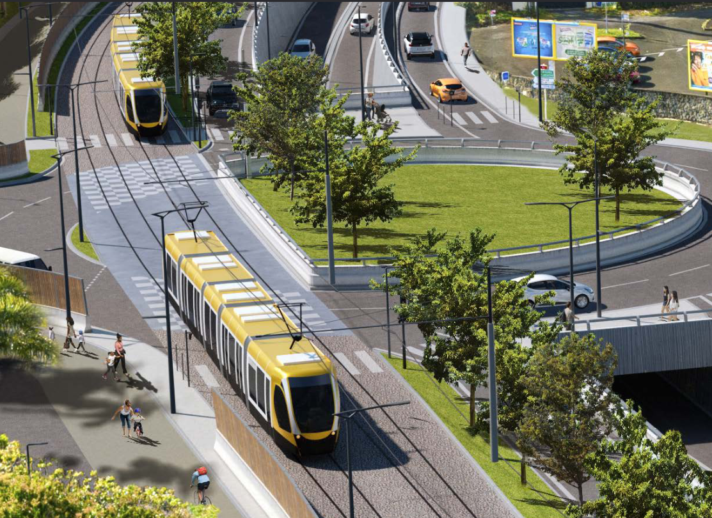
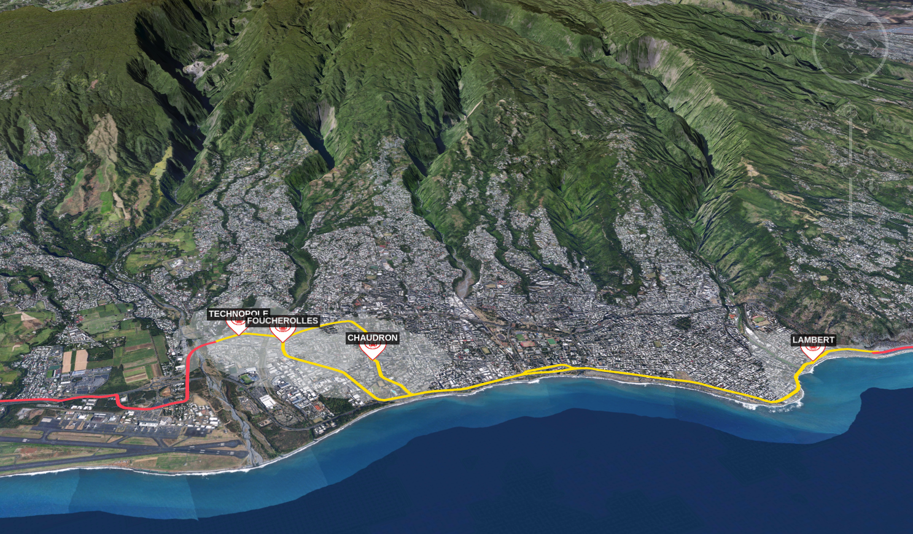
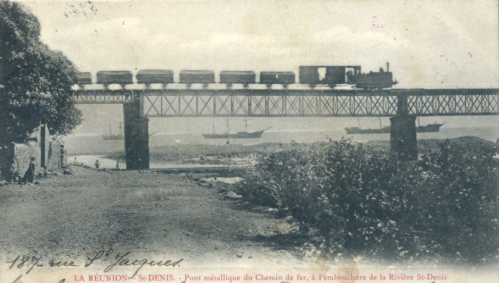
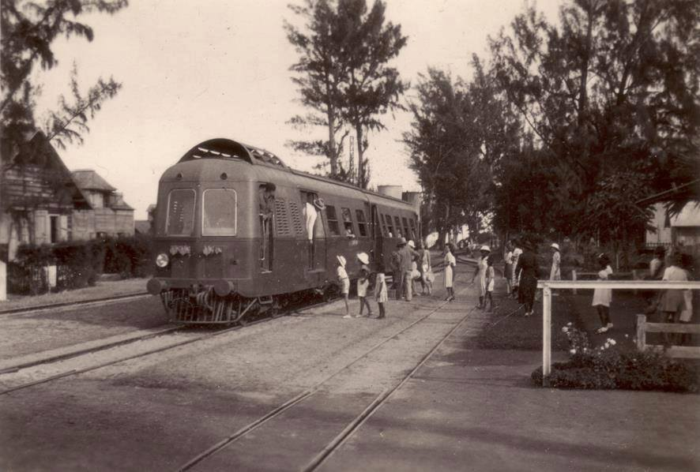
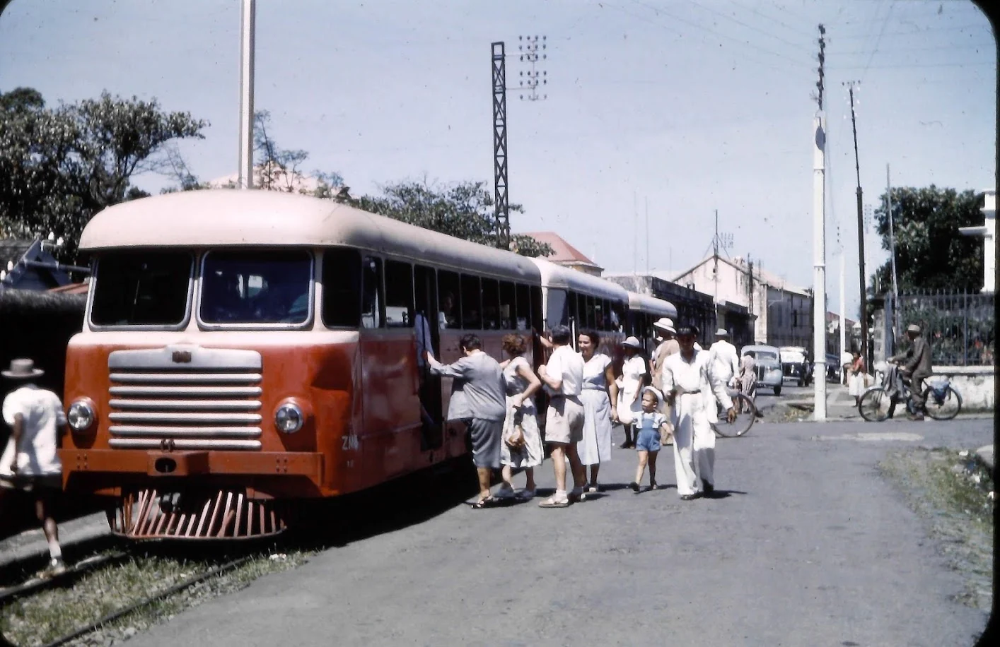

Il y a exactement cinquante ans, la Réunion regardait partir son dernier train sans roulements de tambour. Ce n'est que plus tard, alors qu'ils étaient au volant de leur véhicule, coincés dans un bouchon sur la route du litoral que les habitants ont regretté son absence. Ils ont fait part de cette absence et la région Réunion a entendu leur appel. Elle veut faire revenir le train à la Réunion. Le projet s'appelle **Réunion Express**. La Région et les cinq intercommunalités de l'île ont déjà signé la feuille de route qui prévoit de le faire revenir le train. Il est encore temps d'influencer ce projet car la consultation publique avant son lancement se tient jusqu'au 26 novembre 2026.{.chapo}

## Une consultation citoyenne sur la mobilité

Cette feuille de route ne sort pas de nulle part. Elle est le fruit des **États généraux des mobilités**, lancés le 3 mai 2023 par **Huguette Bello**, présidente de la Région. une consultation citoyenne au niveau régional, sous l'égide de la [Commission nationale du débat public](https://fr.wikipedia.org/wiki/Commission_nationale_du_d%C3%A9bat_public){.ext}.

> L’avènement de la 1ère Assemblée citoyenne, à La Réunion, résulte d’une volonté forte d’aller plus loin, de faire de la démocratie participative une condition essentielle de la gouvernance des grands projets du développement réunionnais.{.lettrine}

Huguette Bello, Présidente de La Région Réunion{.note .sig}

La Région décrit la mobilité de l'île comme le « **coma circulatoire** », fruit de la succession de projets et de concertations inaboutis. Plus de 2,5 millions de déplacements quotidiens, 65 % d'entre eux en voiture, 30 km d'embouteillages chaque jour sur [une bande littorale de moins de 5 km de large](/decouverte/geographie/cartes/divisions/#:~:text=Villes%20/%20campagne) où se concentre l'essentiel de la population.

Il fallait donc faire les choses bien. La consultation s'est faite en deux temps, une phase **maxi-public** où tout le monde était invité à participer et une phase **mini-public** où un groupe restrain et volontaires tirés au sort produit des propositions concrètes sur la base des résultats de la première phase.

La première phase a eu lieu du 9 mai au 23 juillet 2023, avec questionnaire en ligne, mur de contributions, carte participative, caravane dans toutes les communes où chacun et chacunes étaient invité à [organiser des **Ron Kozé**](https://imazpress.com/conseil-regional-actualite/-tats-generaux-des-mobilites-le-mode-d-emploi-de-la-participation){.ext} rencontres-ateliers organisées dans un cadre familier pour élaborer une contribution collective. En ces trois mois, les Réunionnais ont produit **11 000 contributions**.

La deuxième phase des états généraux de la mobilité a été [lancée en octobre 2023](https://www.temoignages.re/mobilites-transport/mobilites/l-assemblee-citoyenne-des-mobilites-est-lancee,108615){.ext} avec la création d'**une Assemblée Citoyenne des Mobilités de 100 personnes**. Elle était composée d’un collège « institutionnel » de 30 personnes élues ou partenaires du conseil régional, et d’un collège « citoyen » composé de 70 personnes toutes volontaires pour travailler sur les propositions pendant 3 mois. 178 personnes s'étaient portées volontaires pendant la première phase. Il a donc fallu tirer au sort 60 personnes parmi ces 178 volontaires. Dix personnes en plus ont été recrutés de façon aléatoire, sur liste téléphonique, pour toucher les profils les moins représentés. Chaque membre de l’assemblée citoyenne a reçu sa lettre de mission le 14 octobre avec pour objectif suivant :
 
> faire le point sur nos usages et nos attentes, dégager des priorités pour améliorer nos déplacements aujourd’hui et anticiper les mobilités de demain.

L’Assemblée Citoyenne des Mobilités a retenu et voté 5 priorités devant guider l’action publique en matière de mobilité à La Réunion :

- Repenser l’aménagement du territoire pour rendre accessibles tous les services de base à moins de 15 minutes, associés à des pôles d’accès multimodaux.
- Réaliser des projets structurants et innovants de transports collectifs et de marchandises.
- Améliorer l’efficacité, la qualité et l’attractivité des réseaux de transports en commun tout en développant l’intermodalité.
- Développer et sécuriser les déplacements en modes doux ou actifs.
- Améliorer la gouvernance partagée en intégrant la participation citoyenne.

L'assemblée n'a pas demandé de directement de train mais ce véhicule sur rail a été mentionné si souvent lors de la première phase qu'il fait partie des trois priorités d’investissements identifiées par la région.

Cette dernière [a donc placé](https://www.regionreunion.com/actualites/le-bilan-des-etats-generaux-des-mobilites/){.ext} le projet ferroviaire Réunion Express comme colonne vertébrale d'un futur réseau global et intermodal, le rail étant le moyen le plus rapide de connecter les réseaux de mobilité de toutes les agglomérations de l'île.

- **Pour aller plus loin:** [Etats généraux des mobilités RAPPORT FINAL DU COLLÈGE DES GARANTS](https://www.debatpublic.fr/sites/default/files/2024-01/Rapport%20final%20des%20garants%20%28EGM%29.pdf){.ext} (PDF) 

## La feuille de rail

Le projet prévoit **140 km de voie férée** entre **Saint-Benoît** et **Saint-Joseph**, via Saint-Denis et Saint-Pierre, avec une infrastructure dissociée du réseau routier pour un coût prévu de **5,2 milliards d'euros**. Une **vingtaine de stations** sont disposées sur le tracée environ tous les 5 km. Un train devrait en partir toutes les **10 à 15 minutes** aux heures de pointe. **100 000 voyageurs** devrait pouvoir emprunter ce train tous les jour. Surtout, une dixaine de stations seront aménagés comme des pôles d'échanges multimodaux, c'est-à-dire qu'ils permettront de passer du train à un autre moyen de transport, bus, câbles, auto ou avion selon les endroits. La collone vertébrale doit être connectée aux autres réseaux de transport de la Réunion.

### Encore une consultation

La création d'une ligne ferroviaire nouvelle a un tel impact sur l'environement que cela oblige les responsables et décideurs à solliciter la CNDP (Commission nationale du débat public). Et comme il faut **améliorer la gouvernance partagée**, la commission a ensuite lancé [un débat public](https://www.debatpublic.fr/projet-train-reunion-express) qui est donc ouvert **du 19 août au 26 novembre 2026** avec des réunions publiques, des ateliers, une [plateforme participative](https://www.debatpublic.fr/projet-train-reunion-express/alon-koze-su-le-proje-dtrin-sur-le-parcours-numerique-9325) titrée *Alon kozé su le projé d’trin ek le parkour numérik*. 

Vue aérienne d'artiste du carrefour Bras Canot à Saint-Benoit{.note}

Les tracés ne sont pas figés et plusieurs variantes sont à l'étude : la traversée de Saint-Denis avec ses options d'articulation avec le Bus à Haut Niveau de Service (BHNF) su projet Baobab et [le téléphérique urbain de la CINOR](https://fr.wikipedia.org/wiki/T%C3%A9l%C3%A9ph%C3%A9rique_urbain_de_la_Cinor){.ext}, la section Saint-Paul–Saint-Leu où s'opposent un tracé à mi-pente le long de la Route des Tamarins et un tracé littoral plus contraint foncièrement, ou encore le franchissement de la Rivière Saint-Étienne côté Pierrefonds. Le site [reunionexpress.re](https://reunionexpress.re/){.ext} propose même un simulateur pour comparer le temps de votre trajet quotidien selon les variantes. Dans tous les cas, le temps gagné sur les trajets en voitures spectaculaires.

J'ai préféré explorer les différents tracés sur une carte. La plus belle étant [la carte de Land Web 3d](https://client.landweb3d.com/cr-reunion/Reunion-Express_mobile/){.ext} qui permet de tout voir en prennant de la hauteur.

Côté calendrier, les études vont se poursuivre après le débat. Pour commencer, il est prévu de lancer les travaux du premier tronçon **Saint-Benoît–Saint-Denis** en 2030 pour une livraison en 2035. La Région Réunion a demandé la labellisation [Service Express Régional Métropolitain](https://fr.wikipedia.org/wiki/Service_express_r%C3%A9gional_m%C3%A9tropolitain){.ext}, la seule d'Outre-mer, et une société locale des grands projets verra le jour pour piloter le chantier.

## On a déjà eu le tram-train

Si ce projet vous rappelle quelque chose, c'est normal. La Réunion a déjà frôlé le train de très près. Sous la présidence de **Paul Vergès**, la Région avait porté dans les années 2000 un projet de **tram-train** : un premier tronçon d'environ 38 kilomètres entre **l'aéroport Gillot** à Sainte-Marie et **Saint-Gilles** dans la commune de Saint-Paul, en passant par Saint-Denis, La Possession et Le Port, avec [une rame de 40 mètres de long](https://www.reunionnaisdumonde.com/magazine/actualites/grands-projets-avortes-le-tram-train-de-la-reunion/){.ext} pouvant transporter 250 passagers. La mise en service était programmée pour 2013.

Le tracé a été débattu en 2006, la consultation des entreprises lancée en 2007, et le 14 août 2009, la Région confiait la réalisation au groupement **Tram'Tiss**, composé des géants Bouygues, Bombardier, Axa et Véolia. Seulement après la crise de 2008, le budget du projet a évolué et la Région a demandé une rallonge de 80 millions d'euros à l'État. Le gouvernement de François Fillon y a opposé une fin de non recevoir. L'alternance politique de mars 2010 a scellé le sort du projet : **Didier Robert**, nouveau président de Région, acte son abandon en mai 2010. Les crédits accordés par le gouvernement, **435 millions d'euros**, ont été redéployés vers la [nouvelle route du littoral](/decouverte/economie/route-corniche/), avec ses viaducs au-dessus de l'océan.

> En matière de transports et de déplacements, comme vous le savez, je ne suis pas favorable au projet sous sa forme actuelle du Tram Train. Les incertitudes financières sont évidentes, les ambiguïtés juridiques le sont tout autant, le risque de geler les finances régionales pour des décennies serait irresponsable pour un projet qui, dans sa forme actuelle, ne concerne que 41 Kms de notre territoire. Nous aurons des réunions organisées dans les prochains jours avec l’ensemble des partenaires pour une décision définitive.

Discours de Didier Robert après son élection comme président de la région Réunion le 26 mai 2010{.note .sig}

On notera sans surprise la géographie politique de l'épisode. Les projets de transports collectifs d'un côté, les bagnoles de l'autre. Pour se rattraper, la nouvelle majorité lancera en 2018 un [projet de tramway baptisé « Écorail](https://www.linfo.re/la-reunion/societe/la-reunion-un-tramway-pour-2022){.ext} entre Saint-Denis et Sainte-Marie, 9 km pour 300 millions d'euros. Prévu pour 2022, le projet n'a jamais vu le jour. Peandant ce temps l'île Maurice [innaugurait son métro](https://fr.wikipedia.org/wiki/Métro_express_de_Maurice){.ext} flambant neuf.

On peut aussi parler du [projet Run Rail](https://la1ere.franceinfo.fr/reunion/run-rail-premier-troncon-reliant-saint-denis-sainte-marie-attendu-2024-688598.html){.ext} qui a été lancé avant l'épidémie de Covid dont le premier tronçon devait être livré en 2024.

Réunion Express est donc le dernier d'une longue lignée de projets. Beaucoup ont avortés pour diverses raisons. Espérons que celui ci se réalise pour de bon. 

## Le ti train lontan, un demi-siècle de rail

Malgré tout, la Réunion a déjà eu des projets ferroviaires qui roulent. La grande période de la révolution industrielle a apporté le train à la Réunion avec un chemin de fer qui a transporté les gens autour de l'île pendant des décénies.

Le projet naît en 1875 à l'initiative de l'ingénieur **Alexandre Lavalley**, qui a travaillé sur le canal de Suez, et de l'homme d'affaires **Eugène Pallu de la Barrière**. Le [projet de chemin de fer](https://baladescreoles.wordpress.com/2008/05/24/alexandre-lavalley-et-eugene-pallu-de-la-barriere/){.ext} est concommitant avec la construction d'un port en eau profonde à la Pointe des Galets pour permettre les échanges commerciaux de la colonie avec le reste du monde. La convention est signée en 1877 et le chantier mobilise près de **8 000 ouvriers**, Réunionnais mais aussi Malgaches, Indiens, Mauriciens, Italiens du Piémont venus creuser le tunnel entre La Possession et Saint-Denis. Au moins 150 morts seront à déplorer sur ce chantier titanesque.

C'est une ligne de **126,2 kilomètres** qui est mise en service le **20 février 1882**, avec 12 gares et 27 haltes, de **Saint-Benoît** à **Saint-Pierre** en passant par La Grande Chaloupe, Saint-Paul et Saint-Leu. À 20-25 km/h de moyenne, il fallait encore 12 heures pour relier Saint-Benoît à Saint-Pierre en 1938, mais c'était mieux que les 2 à 3 jours de cheval du siècle précédent. 

La voie ferrée a connu des trains spéciaux qui ont fait l'histoire. **Le train des maris** a lancé le tourisme balnéaire à la Réunion et a contribué au développement de Saint-Gilles. Il s'appelle ainsi parce que les maris, après le travail dans les zones d'activité, rejoignaient leur familles en villégiature sur la côte à Saint-Gilles. Des trains spéciaux ont aussi transporté **la reine Ranavalona III** lors de son exil sur l'île, ou **les soldats de 1914** enrolés dans les bataillons de tirailleurs de la première guerre mondiale.

Le **Chemin de Fer Port Réunion** est devenu le premier employeur de l'île et terreau du syndicalisme réunionnais.

Dans la deuxième moitié du XXème siècle, l'essort de la voiture fera péricliter la ligne. Le vieux train est plus lent que la voiture. La mise en service d'un autorail pouvant aller a 70km/h ne sera pas suffisant pour rendre le train attractif. La liaison Sud entre Le Port et Saint-Pierre ferme en **1955**. La liaison Nord entre Saint-Denis et Saint-Benoît subit le même sort en **1963**. Les onze derniers kilomètres entre Saint-Denis et La Possession sont définitibement fermés en **1976**. S'en est fini de la CFR.

Si le train disparait du paysage, le patrimoine ne disparaît pas pour autant. Les tunnels, ponts, ponceaux et gares sont encore visibles tout le long de l'ancien tracé. Ce sont aujourd'hui des éléments du patrimoine et de l'histoire de l'île qui se visitent. L'office de tourisme de l'ouest nous propose de visiter [les vestiges du chemin de fer, de la Grande Chaloupe à Saint-Leu](https://www.ouest-lareunion.com/le-ti-train-haltes-gares-et-ponts-ferroviaires-de-l-ouest){.ext}. Au sud, on peut citer la gare de **Saint-Pierre**, boulevard Hubert-Delisle, inscrite aux monuments historiques en 2012 et qui abrite aujourd'hui le Café de la Gare, repère de joueurs de dominos dans la zone touristique du port.

## Ti Train, les passionnés de la Grande Chaloupe

Et qui dit trains dit trainspotting et autres nerds de la vie du rail. La Réunion ne fait pas exception. En janvier **1987**, l'association **Ti Train Lontan** voit le jour autour de passionnés comme Gérard Chotard, Eric Boulogne et Patrick Labonté. Leur terrain de jeu : la gare de la **Grande Chaloupe**, entre mer et montagne, où subsistent quatre kilomètres de voie. Il leur a d'abord fallu rapatrier le matériel éparpillé dans toute l'île : un autorail Billard à l'Étang-Salé, une locomotive à vapeur, une voiture de voyageurs à Sainte-Suzanne. Six mois de travail rien que pour ça.

L'association a connu son heure de gloire entre 1990 et 1996 en participant au spectacle *Lepervenche, chemin de fer* d'Emmanuel Genvrin et de la troupe Vollard : **113 représentations** et **34 000 personnes** transportées en autorail jusqu'au lieu de spectacle. Aujourd'hui, les bénévoles proposent des visites guidées de la gare et de son site classé, avec ses lazarets, les premiers dimanches du mois, la balade à 2 euros quand le matériel roule. Le ti train est actuellement en restauration et les prochaines visites sont annoncées pour le **11 novembre 2026**, sur réservation via HelloAsso.

L'entretien des voies reste un combat quotidien pour l'association, et l'autorail entreposé dans le tunnel ne peut pas en sortir, coincé entre un pont fatigué et une colonie de salanganes. Mais la perspective de voir des trains repasser sur les hauteurs de La Grande Chaloupe à l'horizon 2035 donne un relief nouveau à ce patrimoine. Le ti train lontan attend le train demain au bout de son quai. En attendant, vous avez jusqu'au 26 novembre pour dire ce que vous en pensez.

<!--
consultation:
https://www.regionreunion.com/actualites/le-bilan-des-etats-generaux-des-mobilites/
https://www.temoignages.re/mobilites-transport/mobilites/l-assemblee-citoyenne-des-mobilites-est-lancee,108615

https://www.debatpublic.fr/sites/default/files/2024-01/Rapport%20final%20des%20garants%20%28EGM%29.pdf

https://www.regionreunion.com/actualites/signature-de-la-feuille-de-route-des-mobilites-a-la-reunion/
https://www.regionreunion.com/actualites/reunion-express/

 https://reunionexpress.re/ permet de regarder ce que ça change pour les habitants

https://www.debatpublic.fr/train-express-regional-de-la-reunion-reunion-express-974-8403

projet PDF: https://www.debatpublic.fr/sites/default/files/2025-11/REUNIONEXPRESS-SYNTHESE-DOSSIERSAISINE.pdf
Actus:
https://www.souslesetoiles974.re/actualites/train-reunion-express-2035-transport-ferroviaire/
https://la1ere.franceinfo.fr/reunion/a-quoi-ressemble-le-projet-ferroviaire-reunion-express-colonne-vertebrale-de-la-feuille-de-route-des-mobilites-signee-a-la-region-1617881.html
https://www.zinfos974.com/trace-temps-de-trajet-variantes-ce-que-lon-sait-du-futur-reunion-express/ variantes décrites

discours Denis Robert
https://web.archive.org/web/20111121140120/http://www.mi-aime-a-ou.com/histoire_discours_didier_robert.php

https://www.reunionnaisdumonde.com/magazine/actualites/petite-histoire-du-train-a-la-reunion/

  Chemin de fer à  l'île de la Réunion. https://web.archive.org/web/20080915112303/http://www.mi-aime-a-ou.com/le_train_de_l_ile_de_la_reunion.htm ou https://web.archive.org/web/20111004120142/http://www.mi-aime-a-ou.com/histoire_chemin_de_fer.php 

https://titrain.re/ 
 https://guide-reunion.fr/evenements/eve/association-ti-train/ 

 https://carto.reunionexpress.re/fr/ ne marche pas mais https://strategies-territoires.re/ va réparer ça 

 super carte interactive https://client.landweb3d.com/cr-reunion/Reunion-Express_PC/index_jaune.html mais un peu lourde

-->